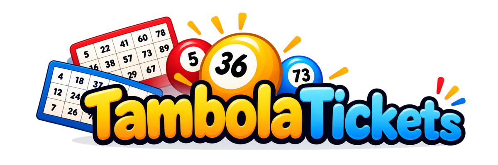
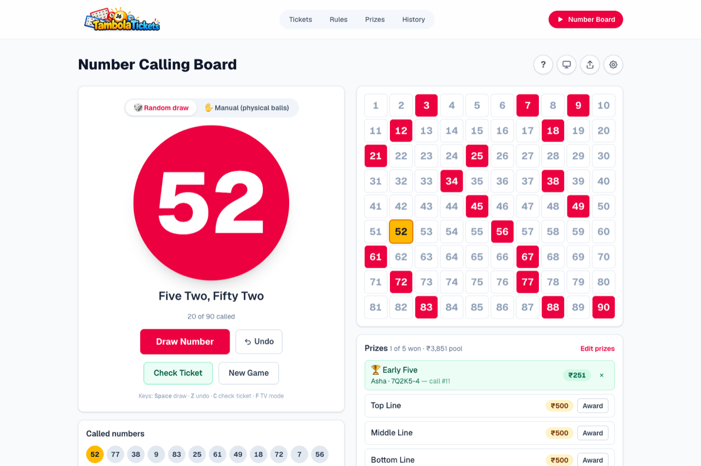
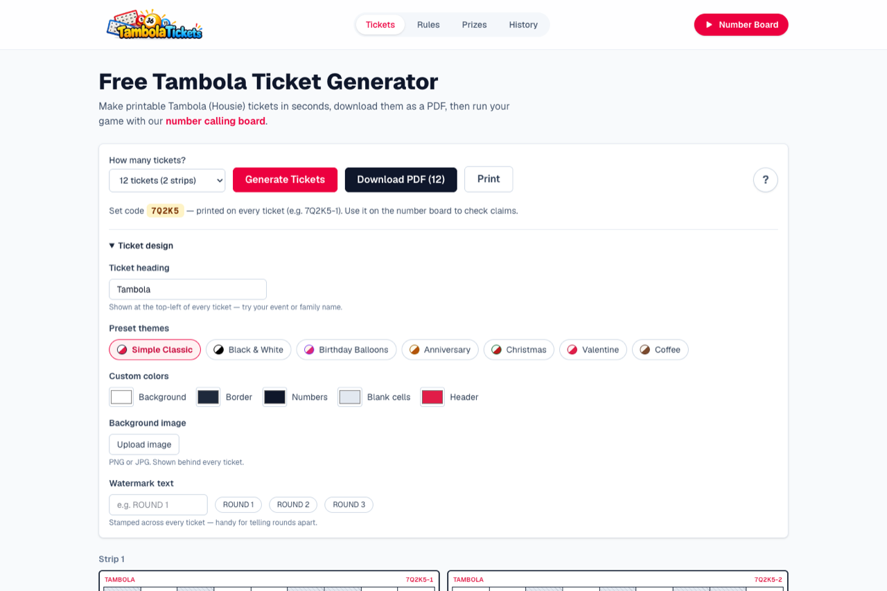
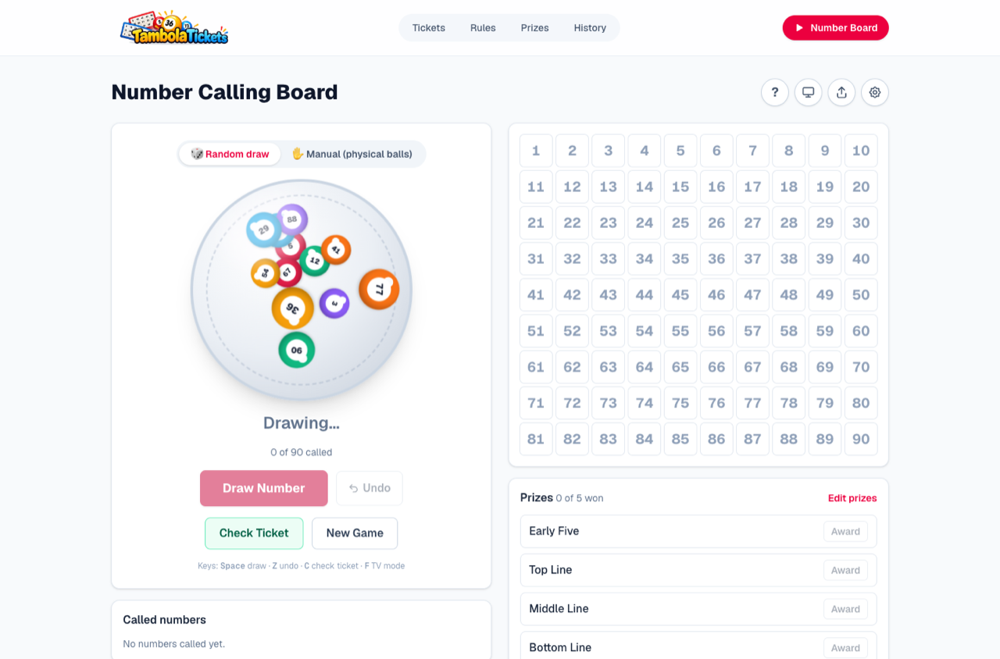
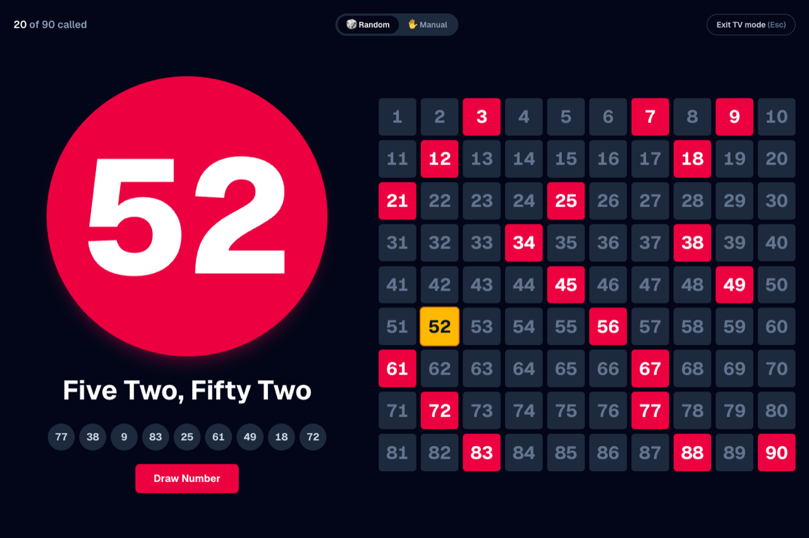
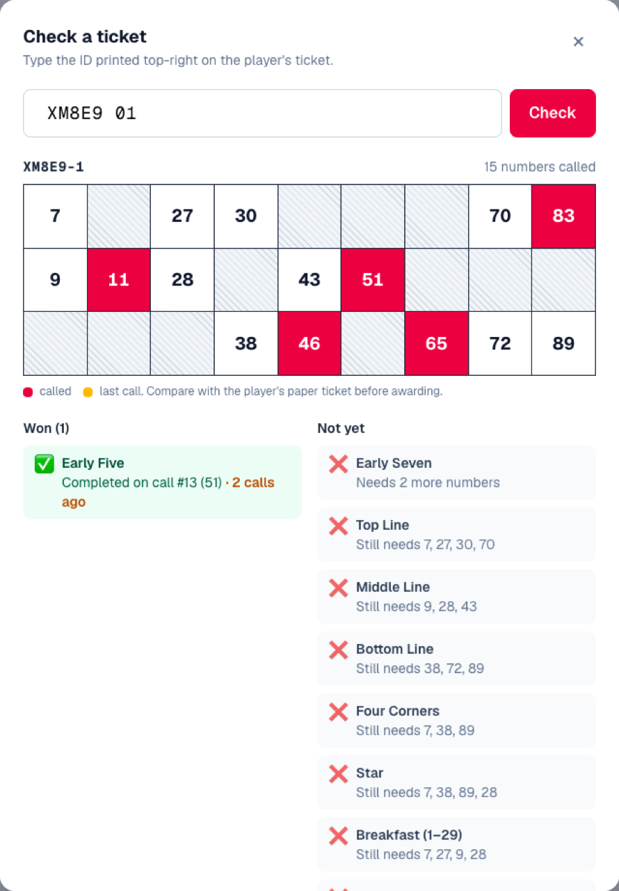
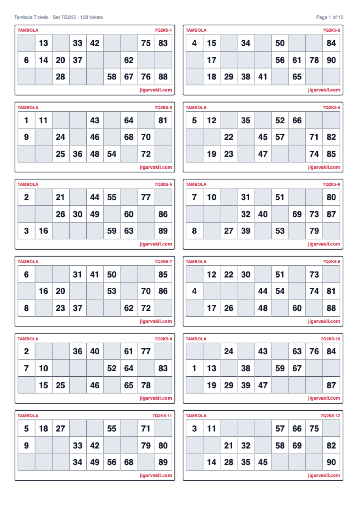
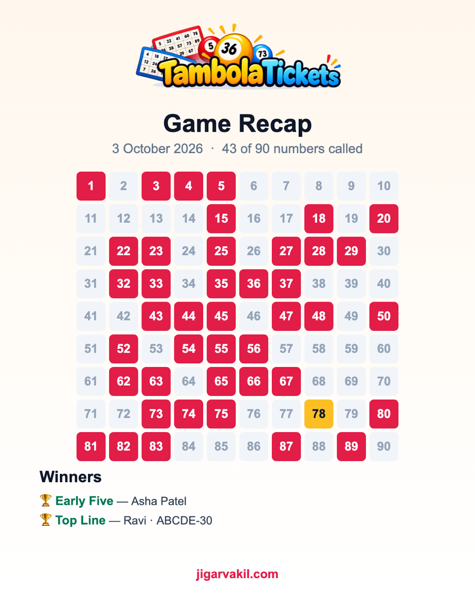

<div align="center">



### Free Tambola (Housie) tickets and a number-calling board for game night

Print valid tickets in seconds, then run the game on the same screen with a ball-machine draw,
voice calls, instant claim checking and a TV mode. Everything runs in the browser, so there's
no sign-up and no server.


</div>

---

<p align="center">
  
</p>

## Features

### 🎟️ Ticket generator
- **Always valid.** Tickets come in strips of 6 that use every number from 1 to 90 exactly once.
  Each ticket has 3 rows × 9 columns, 15 numbers, 5 per row, and columns sorted top to bottom.
- **Print-ready PDF.** 12 tickets per A4 page, up to 120 tickets at a time, generated in the browser.
- **Set codes.** Every ticket carries an ID such as `7Q2K5-37`, which lets the board
  [check claims](#-ticket-checker) later.
- **Your own design.** 7 preset themes, custom colours, a background photo with adjustable opacity,
  a watermark (`ROUND 1`, `ROUND 2`, …) and your own heading (event or family name).

### 🎱 Number-calling board
- **Two ways to play.** In **Random** mode the site draws the numbers. In **Manual** mode you pull
  balls from your own set, type or tap the number, and the board shows it to everyone.
- **A proper show.** Balls tumble in a ball machine, the number pops up big and is read out as
  "two four, twenty four", then flies onto the 1–90 board.
- **Sound effects.** A rattle while drawing and a pop for each number, synthesised with the Web Audio API.
- **Auto-call** every 5–30 seconds, **undo** for a wrong draw, and the game survives a page refresh.
- **TV / projector mode.** Full screen, dark background, giant numbers.
- **Keyboard shortcuts.** <kbd>Space</kbd> draw · <kbd>Z</kbd> undo · <kbd>C</kbd> check ticket · <kbd>F</kbd> TV mode.

### ✅ Ticket checker
When someone claims a prize, type the ID printed on their ticket. The board rebuilds that ticket,
marks the called numbers, and lists which prizes it has won, including the call each prize was
completed on so you can spot late claims.

### 🏆 Prizes and recap
- Choose the prizes for the game (Early Five, lines, corners, Star, Breakfast/Lunch/Dinner,
  Full House, or your own) and set an optional amount (₹) for each.
- Award winners straight from the ticket checker, or by hand.
- At the end, share a **game recap image** of the final board and the winners to WhatsApp.

### ✨ Also included
Guided first-visit tours · a logo splash screen · rules, prizes and history pages · responsive
layout · `sitemap.xml` and `robots.txt`.

## Screenshots

| Tickets and design | Ball machine |
| --- | --- |
|  |  |
| **TV / projector mode** | **Ticket checker** |
|  |  |
| **PDF: 12 tickets per A4 page** | **Game recap to share** |
|  |  |

## How claim checking works without a server

Tickets aren't stored anywhere. Instead, each set of tickets is generated from a **seed**: a
5-character set code such as `7Q2K5`. The same code always produces exactly the same tickets on
any device:

```
set code 7Q2K5  ──seeded PRNG──▶  strip 1, strip 2, …  ──▶  ticket 7Q2K5-37
```

The board only needs the ID printed on a ticket to rebuild it and check it against the numbers
called so far. Each strip has its own seed, so looking up one ticket is instant, and tickets from
several different PDFs can be mixed in the same game.

> [!IMPORTANT]
> The seeded generator in `lib/ticketSet.ts` is **frozen (v1)**. Changing the random-number
> generator, how seeds are derived, or how the ticket generator uses random numbers would make
> old printed tickets stop matching. `tests/ticketSet.test.ts` pins known outputs to catch this.

## Tech stack

| | |
| --- | --- |
| Framework | [Next.js 16](https://nextjs.org) (App Router), React 19, TypeScript |
| Styling | Tailwind CSS 4 |
| PDF | [`@react-pdf/renderer`](https://react-pdf.org), loaded only when you download |
| Tours | [`driver.js`](https://driverjs.com) |
| Browser APIs | Web Speech (voice calls), Web Audio (sound effects), Canvas (recap image), Fullscreen, Web Share |
| Storage | `localStorage` only: the current game, settings, prizes and ticket set |
| Tests | Node's built-in test runner (`node --test`), run directly on TypeScript |

## Getting started

Requires **Node.js 22.18 or later**, which runs the TypeScript tests directly.

```bash
npm install
npm run dev        # http://localhost:3000
```

| Script | What it does |
| --- | --- |
| `npm run dev` | Start the dev server |
| `npm test` | Ticket generator, set codes, prize checks and board logic |
| `npm run lint` | ESLint |
| `npm run build` | Production build (every page is static) |

## Project structure

```
app/                     Routes: / · /number-board · /rules · /prizes · /history
components/
  board/                 Calling board, ball machine, ticket checker, prize tracker, recap, settings
  ticket/                Ticket grid, theme picker, generator UI, PDF document
  tour/                  Guided tours (driver.js)
  ui/                    Shared dialogs and page layout
lib/
  ticketGenerator.ts     Strip generator (6 tickets, all of 1–90)
  ticketSet.ts           Seeded set codes and ticket IDs (frozen v1)
  prizeCheck.ts          Which prizes a ticket has won, and on which call
  numberBoard.ts         Draw / call / undo / restore state
  numberCall.ts          "Two four, twenty four" call text
  sfx.ts                 Synthesised rattle and pop sounds
  recapImage.ts          Canvas recap image
data/                    Themes and the prize catalogue
tests/                   node:test suites
```

## Deployment

Every page is pre-rendered at build time. Deploy to [Vercel](https://vercel.com) or any host that
runs Next.js:

```bash
npx vercel
```

Set `NEXT_PUBLIC_SITE_URL` to your production URL so that `sitemap.xml`, `robots.txt` and the
page metadata use absolute links.

## Roadmap

- [ ] Phone tickets with QR codes: players open their ticket on a phone and tap to mark it
- [ ] Hindi and Gujarati calling (implemented, waiting for a native-speaker review)
- [ ] Works offline and installs as an app (PWA)
- [ ] Festival ticket packs (Diwali, Holi, Navratri)
- [ ] Live multiplayer room where numbers mark themselves on phones (needs a backend)

## Credits

Built by [Jigar Vakil](https://jigarvakil.com).
